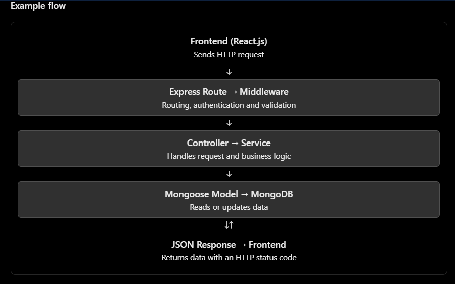

# Mongoose Interview Question & Answer  

## Q 1: What is Mongoose?

***Answer:***  
Mongoose is an ODM (Object Data Modeling) library for MongoDB and Node.js. It makes it easier to interact with MongoDB using JavaScript.  
It allows us to define schemas for our data, create models, validate data, and perform database operations like creating, reading, updating, and deleting documents.  
For example, in an employee management system, we can define a schema for employee details such as name, email, and salary, and use a Mongoose model to save employee data in MongoDB.  
In simple words, Mongoose makes it easier to work with MongoDB by providing schemas, validation, and convenient methods for database operations.  

----
----


## Q 2: Why do we use Mongoose with MongoDB?

***Answer:***  
We use Mongoose with MongoDB because it makes database operations easier in Node.js applications.  
It allows us to define schemas, validate data before saving it, set default values, and perform CRUD operations using simple methods.  
*For example*, in an employee management system, we can use a Mongoose schema to make the employee's name and email required before saving the data to MongoDB.  
In simple words, Mongoose makes it easier to manage MongoDB data by providing schemas, validation, and simple database methods.  

----
----

## Q 3: MongoDB vs Mongoose — what is the difference?

***Answer:***  
MongoDB is a NoSQL database that stores data in documents, while Mongoose is an ODM library that helps Node.js applications interact with MongoDB.  
MongoDB is responsible for storing and managing data, whereas Mongoose provides features like schemas, validation, and models to make database operations easier.  
*For example,* in an employee management system, MongoDB stores employee records, while Mongoose helps us define the employee schema and perform operations like creating, updating, and deleting employees.   
In simple words, MongoDB is the database where we store data, and Mongoose is a library that makes it easier to work with that database using Node.js.   


-----
-----

## Q 4: What is a Mongoose Schema?

***Answer:***  
A Mongoose Schema defines the structure of documents in a MongoDB collection. It specifies which fields a document can have, their data types, and rules such as required fields, default values, and validation.  
*For example,* in an employee management system, we can define a schema with fields like name, email, and salary, specifying that the name and email are required.  
``` 
import mongoose from "mongoose";

const employeeSchema = new mongoose.Schema({
  name: { type: String, required: true },
  email: { type: String, required: true },
  salary: { type: Number, default: 0 }
});
```  
In simple words, a Mongoose Schema defines the structure and validation rules for our data before we save it to MongoDB.  

----
----

## Q 5: What is a Mongoose Model? 

***Answer:***  
A Mongoose Model is created from a Mongoose Schema and provides methods to interact with a MongoDB collection.  
We use models to perform database operations such as creating, finding, updating, and deleting documents.  
*For example,* in an employee management system, we can create an Employee model using the employee schema and use it to save new employees or fetch existing employee records.  
```
const Employee = mongoose.model("Employee", employeeSchema);
```  
Here, Employee is the model created using employeeSchema.  
In simple words, a Schema defines the structure of our data, while a Model allows us to perform database operations on that data.  


----
----

## Q 6: Schema vs Model — what is the difference? 

***Answer:***  
In Mongoose, a Schema and a Model have different purposes.  
A Schema defines the structure of our data, including field names, data types, and validation rules.  
A Model is created from the Schema and provides methods to perform database operations like creating, finding, updating, and deleting documents.  
For example, in an employee management system, we define an employee Schema with fields like name, email, and salary. Then, we create an Employee Model from that Schema to save and retrieve employee data in MongoDB.  
In simple words, a Schema defines how the data should look, while a Model helps us work with that data in MongoDB.  

----
----

### Explain this code 

```
import { Document, model, Schema, Types } from "mongoose";
import { TaskStatus } from "../shared/enums";


export interface ITask extends Document {
    _id: Types.ObjectId;
    
    title: string;
    description?: string;

    status: TaskStatus;
    priority: number;

    siteId: Types.ObjectId;
    assignedToId?: Types.ObjectId;
    assignedById?: Types.ObjectId;

    dueDate?: Date;
    completedAt?: Date;
}

const taskSchema = new Schema<ITask>(
    {
        title: {
            type: String,
            required: true,
            trim: true
        },

        description: {
            type: String,
            trim: true
        },

        status: {
            type: String,
            enum: Object.values(TaskStatus),
            default: TaskStatus.PENDING,
            required: true,
            index: true
        },

        priority: {
            type: Number,
            min: 1,
            max: 5,
            default: 1,
            required: true
        },

        siteId: {
            type: Schema.Types.ObjectId,
            ref: "Site",
            required: true,
            index: true
        },

        assignedToId: {
            type: Schema.Types.ObjectId,
            ref: "Employee",
            index: true
        },

        assignedById: {
            type: Schema.Types.ObjectId,
            ref: "User",
            required: true,
            index: true
        },

        dueDate: {
            type: Date
        },

        completedAt: {
            type: Date
        }
    },
    {
        timestamps: true,
        collection: "tasks"
    }
);

taskSchema.index({
    siteId: 1,
    status: 1
});

export const Task = model<ITask>("Task", taskSchema);
```  
Your code has four main parts:  
1. Interface (ITask) — defines the TypeScript types for task data.
2. Schema (taskSchema) — defines the structure, validation rules, defaults, and indexes.
3. Indexes — help MongoDB find matching tasks more efficiently.
4. Model (Task) — provides methods to create, find, update, and delete tasks.  

This is a Task Model built using Mongoose and TypeScript. First, I define an interface to specify the types of task fields. Then, I create a schema to define field validation, default values, references, and timestamps. I use ObjectId references to connect tasks with sites, employees, and users. I also add individual and compound indexes to improve query performance. Finally, I create and export the Task model, which I use to perform CRUD operations on the tasks collection in MongoDB.  

Bro, the most important difference to remember is: the interface defines types for TypeScript, the schema defines rules for Mongoose, and the model lets you interact with MongoDB.  


----
----

## Q 7: How do you connect Node.js with MongoDB?

***Answer:***  
We can connect Node.js with MongoDB using the MongoDB native driver or Mongoose. In most of my projects, I use Mongoose because it makes database operations easier.  
First, we install Mongoose using npm install mongoose. Then, we import it and use mongoose.connect() with the MongoDB connection string to establish the connection.  
```
import mongoose from "mongoose";

const connectDB = async () => {
  try {
    await mongoose.connect(process.env.MONGODB_URI!);
    console.log("MongoDB connected successfully");
  } catch (error) {
    console.error("MongoDB connection failed:", error);
    process.exit(1);
  }
};

export default connectDB; 
```  
Here, the connection string is stored in an environment variable instead of being hardcoded. We use async/await to wait for the connection and try...catch to handle errors.  
In simple words, we use mongoose.connect() with a MongoDB connection string to connect our Node.js application to the database.  

----
----

## Q 8: What is populate() in Mongoose? 

***Answer:***  
`populate()` in Mongoose is used to get related data from another collection using a reference `(ref)`.  
*For example,* suppose we have two collections: User and Task. Each task stores a userId that refers to a user. Using populate(), we can get the user's details instead of only getting the user ID.  
```
const tasks = await Task.find().populate("userId");
```  
Here, Mongoose replaces the referenced userId with the matching user document.  
In simple words, populate() helps us fetch related data from another collection using a reference.  

----
----

## Q 9: What are Mongoose validators?

***Answer:***  
Mongoose validators are used to check whether the data meets specific rules before saving it to MongoDB.  
For example, we can make a field required, set a minimum value, or validate an email format.  
```
const userSchema = new mongoose.Schema({
  name: {
    type: String,
    required: true,
  },
  age: {
    type: Number,
    min: 18,
  },
});
```  
Here, name is required, and age must be at least 18. If the data fails validation, Mongoose throws a validation error.  
In simple words, validators help us prevent invalid data from being saved to the database.  


----
----

## Q 10: What are timestamps: true? 

***Answer:***  
In Mongoose, `timestamps:` true automatically adds two fields to every document: createdAt and updatedAt.  

- `createdAt` stores when the document was created.  
- `updatedAt` stores when the document was last updated.  
**Example:**  
```
const userSchema = new mongoose.Schema(
  {
    name: {
      type: String,
      required: true,
    },
  },
  {
    timestamps: true,
  }
); 
```
When we create a user, Mongoose automatically sets both timestamps. When we update the user, Mongoose updates the updatedAt field. 
In simple words, timestamps: true automatically tracks when a document is created and last updated.  

----
----


## Q 11: How do you implement authentication in Node.js/Express?

***Answer:***  
In Node.js and Express, we can implement authentication using JWT (JSON Web Token) and password hashing with bcrypt.  
The process has these steps:
1. Register: The user submits their details, and we hash the password using bcrypt before saving it to MongoDB.
2. Login: We verify the user's credentials by comparing the password with the hashed password.
3. Generate JWT: If the credentials are correct, we generate a JWT token and send it to the user.
4. Authentication middleware: For protected routes, middleware verifies the token and allows access only if it is valid.  

In simple words, authentication verifies who the user is. We use bcrypt to protect passwords and JWT to authenticate users on protected routes. 
 
----
----

## Q 12: What is JWT and how does JWT authentication work?  

***Answer:***  
JWT stands for `JSON Web Token`. It is used to securely transfer information between a client and a server and is commonly used for authentication.  
JWT authentication works in these steps:
1. Login: The user sends their email and password to the server.
2. Verify credentials: The server checks whether the credentials are correct.
3. Generate token: The server generates a JWT and sends it to the client.
4. Send token: The client sends the token with requests to protected APIs, usually in the Authorization header.
5. Verify token: Authentication middleware verifies the token. If it is valid, the user can access the protected route.  

```
Authorization: Bearer <token>
``` 

In simple words, JWT allows the server to verify a user's identity using a token instead of asking for their password with every request.  

----
----

## Q 13: Why do we use bcrypt for passwords?

***Answer:***  
We use bcrypt to hash passwords before storing them in the database. We should never store passwords in plain text because if the database is compromised, users' passwords could be exposed.  
Bcrypt converts a password into a secure hash. During login, we use bcrypt.compare() to compare the entered password with the stored hash.  
```
Bcrypt converts a password into a secure hash. During login, we use bcrypt.compare() to compare the entered password with the stored hash.
```  
Here, 10 is the salt rounds value, which controls the computational cost of hashing.  
In simple words, bcrypt protects user passwords by storing their hashes instead of the original passwords.  

----
----

## Q 14: What is the difference between authentication and authorization?

***Answer:***  
Authentication means verifying who the user is, while Authorization means checking what the user is allowed to access.  
For example, when a user logs in using their email and password, that is authentication. After login, if only an admin can delete users, checking whether the logged-in user has admin permission is authorization.   

In simple words, Authentication means “Who are you?” and Authorization means “What are you allowed to do?”  

----
----

## Q 15: Explain the complete flow of a backend API from request to database and back to the client. 

***Answer:***  
When a client sends a request to a backend API, the request passes through several layers before the server sends a response back.  
The complete flow works like this:
1. Client Request: The frontend sends an HTTP request to the backend using Axios or Fetch.
2. Route: Express checks the URL and HTTP method and directs the request to the correct route.
3. Middleware: Middleware handles tasks such as authentication, validation, and logging.
4. Controller: The controller receives the request and handles the request-response logic.
5. Service: The service contains the business logic and processes the required operation.
6. Model/Database: The model communicates with MongoDB using Mongoose to read or modify data.
7. Response: The result returns to the controller, which sends an appropriate HTTP response to the client.  

  
In simple words, the request goes from the frontend to the route, middleware, controller, service, and database. The result then comes back to the frontend as an HTTP response.  

----
----

